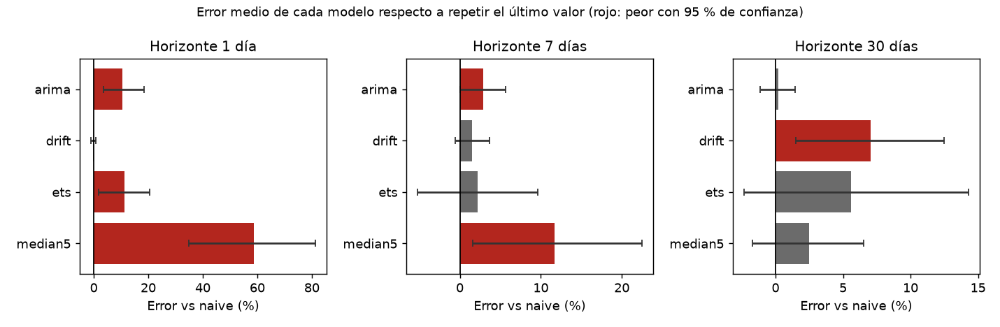

# dop-usd-backtest

Un backtest honesto de pronósticos de la tasa USD a DOP: cinco modelos contra el más simple de todos (repetir el último valor), con origen móvil y sin mirar el futuro.

Lo hice para practicar la parte de pronosticar que casi siempre se hace mal: medir. Es fácil ajustar un ARIMA y mostrar una curva bonita. Lo difícil es comprobar que le gana a no hacer nada.

**Stack:** Python 3.13 · pandas · statsmodels · pytest · uv

## Resultado

Ningún modelo le gana al último valor. Datos: 972 días (2024-03-06 a 2026-11-02), 83 orígenes (uno cada 7 días, con al menos un año de historial). La tabla es el error absoluto medio en pesos por dólar y cuánto más (+) o menos (-) error tiene cada modelo que el naive. El intervalo es del 95 % para esa diferencia, con bootstrap por bloques.

| Modelo | h=1 día | h=7 días | h=30 días |
|---|---|---|---|
| naive (último valor) | 0.176 | 0.465 | 1.100 |
| drift (tendencia del último año) | -0.2 % (incluye 0) | +1.5 % (incluye 0) | **+7.0 %, peor** |
| ETS con tendencia amortiguada | **+11.2 %, peor** | +2.2 % (incluye 0) | +5.6 % (incluye 0) |
| ARIMA(1,1,1) | **+10.6 %, peor** | **+2.9 %, peor** | +0.2 % (incluye 0) |
| mediana de 5 días | **+58.7 %, peor** | **+11.7 %, peor** | +2.5 % (incluye 0) |

"Peor" significa que el intervalo de la diferencia queda entero por encima de cero. "Incluye 0" significa que con 83 orígenes no puedo distinguirlo del naive en ninguna dirección. El acierto de dirección (si el modelo adivina si sube o baja) no pasa de 57 % en ningún caso, y la mayoría queda por debajo de 50 %.



La tabla completa, con los intervalos, sale de `uv run python -m dopusd.backtest` y queda en `results/summary.csv`.

## Cómo está hecho

- `fetch.py` baja la tasa día por día a `data/usd_dop.csv`.
- `backtest.py` recorre los orígenes. En cada uno le pasa al modelo solo `values[: origen + 1]` y compara con el valor `h` días después.
- `models.py` tiene los cinco pronosticadores. Todos tienen la misma firma, así que agregar uno son diez líneas.
- Los intervalos usan bootstrap por bloques circulares. Con un origen por semana y horizonte de 30 días, los orígenes vecinos comparten parte del recorrido; remuestrear uno por uno haría los intervalos más estrechos de lo que son.

## Cómo correrlo

```bash
uv sync
uv run python -m dopusd.backtest      # usa data/usd_dop.csv, que ya está en el repo
uv run pytest
```

Para volver a bajar los datos: `uv run python -m dopusd.fetch` (tarda un minuto, unas mil peticiones).

## Lo que hay que saber antes de creerle

- **Los datos no son la tasa oficial.** Vienen de `fawazahmed0/currency-api`, un agregado gratuito publicado en jsDelivr. No es la tasa del Banco Central ni la de ningún banco. Tiene ruido: el 2026-09-29 marca 57.72 cuando el día anterior y el siguiente rondan 59.5, un valor suelto que no se repite. La autocorrelación de los retornos diarios es de -0.24, más negativa de lo que esperaría de una moneda que se mueve poco, y creo que es en parte ese ruido. No limpié la serie: un filtro centrado miraría el futuro de cada origen.
- **Es una serie, dos años y 83 orígenes.** Sirve para ver que ARIMA y ETS no aportan aquí. No dice nada de otras monedas ni de otros periodos.
- **Un día falta** (2025-12-10) y lo interpolo en línea recta.
- **No hay modelos con variables externas** (inflación, tasa de política monetaria, reservas). Un modelo así quizá le gane al naive, pero habría que conseguir esos datos con la misma fecha de publicación que tendría un usuario real, y no los conseguí.
- **No es una recomendación de nada.**

Las decisiones y lo que descarté están en [docs/decisions.md](docs/decisions.md).
